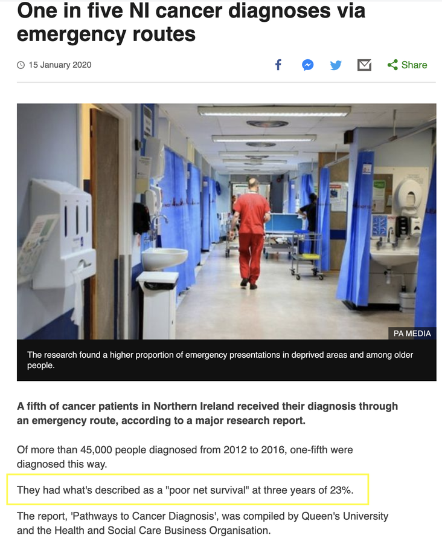

## Lecture aims

::: {.content-visible when-format="revealjs"}
::: {.hidden}
$$
\newcommand{\bbeta}{\boldsymbol{\beta}}
\newcommand{\bpsi}{\boldsymbol{\psi}}
\newcommand{\bx}{\mathbf{x}}
\newcommand{\bz}{\mathbf{z}}
\require{color}
\definecolor{popcol}{RGB}{31,111,181}
\definecolor{exccol}{RGB}{198,40,40}
\newcommand{\pop}[1]{{\color{popcol}{#1}}}
\newcommand{\exc}[1]{{\color{exccol}{#1}}}
\newcommand{\exeq}{\overset{\text{(exercise)}}{=}}
$$
:::
:::

-   Introduce the relative survival framework.
-   Introduce a general hazard structure.
-   Present an application in cancer epidemiology.
-   Discuss a challenge in the relative survival framework.

# The relative survival framework {background-color="#341B51"}

## Cancer epidemiology

-   We are exposed to many forces of mortality: ageing, illnesses, natural disasters, accidents, crime, COVID-19, and so on.
-   Cancer is a strong force of mortality that affects large groups of individuals in all countries.
-   Cancer patients, the population of interest in cancer epidemiology, are exposed to the additional force of mortality due to cancer.
-   The aim is to quantify the survival of cancer patients in order to compare cancer management across countries. For this, we need comparable quantities.

## The typical data set

-   A sample of **times to event**, possibly right-censored, $(t_1,\ldots,t_n)$, from a group of individuals.
-   The vital status (or **censoring indicators**) $(\delta_1,\ldots,\delta_n)$: $\delta_i=1$ for death, $\delta_i=0$ for right-censored (alive). Censoring may be due to random drop-out, loss to follow-up, or administrative censoring.
-   In some cases, we also know some characteristics of the individuals: **covariates** $\bx_i = (x_{i1},\ldots,x_{ip})^{\top}$, such as age, sex, deprivation level, comorbidities or tumour stage.

## Survival analysis frameworks

There are three approaches to analysing survival data:

1.  **Overall survival:** all-cause mortality is analysed. Not useful for comparisons between populations, as they are exposed to different causes of mortality.
2.  **Cause-specific:** the cause of death is known. However, death certificates are highly unreliable in all countries.
3.  **Relative survival:** we separate the [hazard associated with other causes]{.pop} from the [hazard associated with cancer]{.exc}.

## Relative survival framework

-   We would like to quantify the [mortality hazard due to the cancer]{.exc} under study, and link it to the patients' characteristics.
-   In the relative survival framework, we assume that the [expected mortality hazard]{.pop} (from causes other than cancer) can be obtained from the general [population life tables](https://www.ons.gov.uk/peoplepopulationandcommunity/birthsdeathsandmarriages/lifeexpectancies/datasets/nationallifetablesunitedkingdomreferencetables).

## Excess mortality hazard regression models

-   More specifically, we decompose the individual observed hazard, $h_o(\cdot;\cdot)$, as
    $$
    h_o(t;\bx) = \pop{h_P(A+t;\bz)} + \exc{h_E(t;\bx)},
    $$
    where $A$ is the age at diagnosis, [$h_P(A+t;\bz)$ is the population hazard]{.pop}, obtained from the life tables ($\bz \subset \bx$: age, sex, deprivation, ...), and [$h_E(t;\bx)$ is the excess hazard]{.exc}.

## Assumptions of the relative survival framework

-   [The general population hazard correctly reflects the other-causes hazard in our population of interest.]{.pop}
-   [The excess hazard is interpreted as the hazard due to the cancer under study.]{.exc}

## Background mortality

-   To calculate $\pop{h_P(A+t;\bz)}$, we need the life tables produced by the country where the patients live. These are publicly available.
-   Depending on the country, life tables are defined by different characteristics $\bz$; typically age, sex and year.
-   In the UK, life tables are also available by deprivation level (1--5).
-   Example: a patient with characteristics $\bz_i = (\text{age} = 70,\ \text{sex} = \text{male},\ \text{deprivation} = 3,\ \text{year of diagnosis} = 2010)$ and $t_i = 1$ year $\longrightarrow$ 2011 life table $\longrightarrow$ extract the corresponding mortality rate.

## Net survival

-   The main quantity of interest is the **net survival**, the survival function associated with the excess hazard:
    $$
    S_N(t;\bx) = \exp\left\{ - \int_0^{t} \exc{h_E(s;\bx)}\, ds\right\}.
    $$
-   It is not affected by differences in population mortality, so it is useful for comparing cancer management between countries or periods.
-   Policy-making is often based on the **population net survival**, $S_N(t) = \frac{1}{n}\sum_{i=1}^n S_N(t;\bx_i)$.

## Net survival in the news

:::: {.columns}
::: {.column width="40%"}
{fig-align="center" height="540px"}
:::

::: {.column width="60%"}
::: {.nonincremental}
-   BBC News, 15 January 2020: one in five cancer diagnoses in Northern Ireland happen via emergency routes.
-   Those patients had a "poor net survival" at three years of 23%.
-   Net survival is the quantity routinely reported in population-based cancer research and in policy documents.
:::
:::
::::

# The general hazard structure {background-color="#341B51"}

## Which parametric excess hazard model?

-   The excess hazard is typically modelled as
    $$
    h_E(t;\bx) = h_0(t)\exp\left(\bx^{\top}\bbeta\right).
    $$
-   **Fully parametric** models are of interest, since they allow for prediction beyond the follow-up period, and they are typically more parsimonious.
-   The main criticisms are: (i) the PH assumption does not account for time-varying effects, and (ii) the distributions used to model the baseline hazard can only capture specific shapes.

## The proposed model

-   Aims [@R18]: (i) consider more general alternatives to the PH structure; (ii) use a parametric baseline that can capture the basic shapes of interest.
-   For (i), to go beyond proportional hazards, we consider the **general hazard (GH)** structure [@C01]:
    $$
    \begin{aligned}
    h_{\text{E}}^{\text{GH}}\left(t;\bx_i\right) &= h_0\left(t \exp(\bx_i^{\top}\bbeta_1)\right)\exp(\bx_i^{\top}\bbeta_2),\\
    H_{\text{E}}^{\text{GH}}\left(t;\bx_i\right) &\exeq H_0\left(t \exp(\bx_i^{\top}\bbeta_1)\right)\exp(\bx_i^{\top}\bbeta_2 - \bx_i^{\top}\bbeta_1).
    \end{aligned}
    $$

## Special cases of the GH structure

(i) If $\bbeta_1=\mathbf{0}$, then GH = **PH** (proportional hazards):
    $$
    h_{\text{E}}^{\text{PH}}\left(t;\bx_i\right) = h_0(t)\exp\left(\bx_i^{\top}\bbeta\right).
    $$
(ii) If $\bbeta_2=\mathbf{0}$, then GH = **AH** (accelerated hazards):
    $$
    h_{\text{E}}^{\text{AH}}\left(t;\bx_i\right) = h_0\left(t \exp(\bx_i^{\top}\bbeta)\right).
    $$
(iii) If $\bbeta_1=\bbeta_2$, then GH = **AFT** (accelerated failure time):
    $$
    h_{\text{E}}^{\text{AFT}}\left(t;\bx_i\right) = h_0\left(t \exp(\bx_i^{\top}\bbeta)\right)\exp(\bx_i^{\top}\bbeta).
    $$

## Time-dependent effects: $\beta_1$

The GH structure includes time-dependent effects through $\bbeta_1$, which rescales time inside the baseline hazard: $h_0\left(t\, e^{\beta_1}\right)$.

::: {.content-visible when-format="revealjs"}
```{=html}
<div class="gh-widget" data-mode="time" data-min="-1.5" data-max="1.5" data-value="0.8" data-step="0.05" data-ymax="0.2" data-label="β₁"></div>
```
:::

::: {.content-visible when-format="beamer"}
{fig-align="center" width="58%"}
:::

## Hazard-level effects: $\beta_2$

The GH structure includes hazard-level effects through $\bbeta_2$, which multiplies the baseline hazard: $h_0(t)\, e^{\beta_2}$.

::: {.content-visible when-format="revealjs"}
```{=html}
<div class="gh-widget" data-mode="level" data-min="-1" data-max="1" data-value="0.5" data-step="0.05" data-ymax="0.6" data-label="β₂"></div>
```
:::

::: {.content-visible when-format="beamer"}
{fig-align="center" width="58%"}
:::

## The baseline hazard

-   For the second aim, we use the [exponentiated Weibull distribution](https://rpubs.com/FJRubio/EWD) [@M96], a simple transformation of the Weibull distribution $F(t \mid \kappa, \sigma)$:
    $$
    G(t \mid \kappa, \sigma,\alpha) = F(t \mid \kappa, \sigma)^{\alpha}.
    $$
-   The corresponding hazard can be unimodal, increasing, decreasing, constant or bathtub-shaped: the "basic shapes" of the hazard function.
-   The GH structure with an EW baseline hazard covers both aims. $\checkmark$
-   Alternatives include the generalised gamma, the [power generalised Weibull](https://rpubs.com/FJRubio/PGW) and the [generalised Weibull](https://rpubs.com/FJRubio/GWD) distributions.

## Maximum likelihood estimation

The likelihood function of the parameter vector $\bpsi$ is

$$
\begin{aligned}
\mathcal{L}_0(\bpsi;\text{data}) &= \prod_{i=1}^n h_o(t_i;\bx_i)^{\delta_i}S_o(t_i;\bx_i)
= \prod_{i=1}^n h_o(t_i;\bx_i)^{\delta_i}\exp\left\{-H_o(t_i;\bx_i)\right\}\\
&\exeq \prod_{i=1}^n \left\{ \pop{h_{\text{P}}(A_i+t_i;\bz_i)}+ \exc{h_{\text{E}}(t_i;\bx_i)} \right\}^{\delta_i} \exp\left\{- \exc{H_{\text{E}}(t_i;\bx_i)}\right\}\\
&\qquad\times \exp\left\{- \pop{\left[H_{\text{P}}(A_i+t_i;\bz_i) -H_{\text{P}}(A_i;\bz_i)\right]}\right\}\\
&\propto \prod_{i=1}^n \left\{ \pop{h_{\text{P}}(A_i+t_i;\bz_i)}+ \exc{h_{\text{E}}(t_i;\bx_i)} \right\}^{\delta_i} \exp\left\{- \exc{H_{\text{E}}(t_i;\bx_i)}\right\}.
\end{aligned}
$$

. . .

The population cumulative hazard does not depend on $\bpsi$, so it can be dropped: only the population hazard *rate* at death is needed.

## Software and examples

::: {.nonincremental}
-   The GH model is implemented, in both the overall and relative survival frameworks, in the R package [GHSurv](https://github.com/FJRubio67/GHSurv).
-   Simulating times to event from the GH structure: [GHSim](https://rpubs.com/FJRubio/GHSim){.pill}
-   A simulated data example: [GHGH](https://rpubs.com/FJRubio/GHGH){.pill}
-   Simulating times to event from a life table: [SimLT](https://github.com/FJRubio67/SimLT){.pill}
:::

# Application: lung cancer in women {background-color="#341B51"}

## Real data application

-   Data from a population-based national cancer registry: lung cancer patients diagnosed in 2012 in the United Kingdom.
-   We restricted the analysis to women with no missing data.
-   We observed *n* = 14,557 complete cases, of whom *n*~o~ = 12,138 died before 31 December 2015.
-   The median follow-up among censored patients was 3.46 years.

## Covariates

::: {.nonincremental}
-   **Age at diagnosis.** Quartiles 64.9, 72.6 and 80.2 years; mean 72.0 years.
-   **Tumour stage (I--IV).** Stage I: 2,434; stage II: 1,131; stage III: 3,421; stage IV: 7,751.
-   **Income score** (income domain of the England Indices of Multiple Deprivation). Continuous on $(0,1)$.
-   **Comorbidity:** presence of cardiovascular disease. 4,318 patients had comorbidity indicator 1.
:::

## Model

-   We use the EW baseline hazard (3 parameters).
-   We fit four models for the excess hazard: PH, AFT, AH and GH.
-   The likelihood is maximised using the R function `optim()`.
-   We select a model using AIC.

## Results: estimates (standard errors) {.compact}

```{=latex}
\tiny
```

|                         | PH-EW          | AH-EW            | AFT-EW         | GH-EW              |
|:--|:--:|:--:|:--:|:--:|
| *Baseline (EW)*         |                |                  |                |                    |
| Scale                   | 0.059 (0.038)  | 8.482 (0.724)    | 1.190 (0.175)  | 1.838 (0.374)      |
| Shape                   | 0.188 (0.014)  | 0.539 (0.046)    | 0.385 (0.012)  | 0.442 (0.033)      |
| Power                   | 9.175 (1.420)  | 1.483 (0.129)    | 4.387 (0.312)  | 3.593 (0.368)      |
| *Time scale,* $\bbeta_1$|                |                  |                |                    |
| Age at diagnosis        | --             | −0.112 (0.006)   | --             | 0.041 (0.004)      |
| Stage II                | --             | −2.977 (0.282)   | --             | 0.691 (0.311)      |
| Stage III               | --             | −6.680 (0.337)   | --             | 1.707 (0.229)      |
| Stage IV                | --             | −10.469 (0.416)  | --             | 3.413 (0.226)      |
| Income score            | --             | −2.668 (0.416)   | --             | 0.822 (0.448)      |
| Comorbidity             | --             | −1.021 (0.106)   | --             | 0.539 (0.114)      |
| *Hazard level,* $\bbeta_2$ |             |                  |                |                    |
| Age at diagnosis        | 0.022 (0.001)  | --               | 0.032 (0.001)  | 0.034 (0.001)      |
| Stage II                | 0.721 (0.056)  | --               | 0.881 (0.065)  | 0.845 (0.069)      |
| Stage III               | 1.473 (0.043)  | --               | 1.909 (0.050)  | 1.849 (0.053)      |
| Stage IV                | 2.211 (0.041)  | --               | 3.003 (0.046)  | 3.073 (0.050)      |
| Income score            | 0.527 (0.085)  | --               | 0.744 (0.115)  | 0.750 (0.150)      |
| Comorbidity             | 0.192 (0.021)  | --               | 0.289 (0.029)  | 0.349 (0.039)      |
| **AIC**                 | 20523.141      | 20855.753        | 20189.124      | **20164.911**      |

::: {.table-note}
Reference category for stage: stage I. In the AFT model $\bbeta_1=\bbeta_2$, so its single set of coefficients is shown once. Age and income score are centred.
:::

## Net survival

-   We now calculate net survival at $t = 1, 2, 3$ and $3.9$ years after diagnosis for two groups:
    1.  the total population, by comorbidity (0, 1);
    2.  patients aged 55--65 at stage I, by comorbidity (0, 1).
-   We compare the estimates from the selected parametric model (GH-EW) with those from the nonparametric **Pohar Perme estimator** [@PS12].

## Net survival: total population {.compact-lg}

Net survival estimates (lower, upper):

```{=latex}
\footnotesize
```

| Comorbidity | Year | GH-EW | Pohar Perme |
|:--:|:--:|:--:|:--:|
| 0 | 1   | 0.407 (0.401, 0.416) | 0.408 (0.398, 0.418) |
|   | 2   | 0.270 (0.265, 0.278) | 0.268 (0.259, 0.277) |
|   | 3   | 0.204 (0.199, 0.211) | 0.209 (0.201, 0.218) |
|   | 3.9 | 0.167 (0.162, 0.174) | 0.182 (0.172, 0.191) |
| 1 | 1   | 0.380 (0.371, 0.391) | 0.370 (0.356, 0.385) |
|   | 2   | 0.254 (0.246, 0.264) | 0.238 (0.225, 0.252) |
|   | 3   | 0.193 (0.185, 0.203) | 0.169 (0.158, 0.182) |
|   | 3.9 | 0.158 (0.150, 0.168) | 0.138 (0.126, 0.152) |

## Net survival: aged 55--65 at stage I {.compact-lg}

Net survival estimates (lower, upper):

```{=latex}
\footnotesize
```

| Comorbidity | Year | GH-EW | Pohar Perme |
|:--:|:--:|:--:|:--:|
| 0 | 1   | 0.924 (0.914, 0.935) | 0.928 (0.897, 0.960) |
|   | 2   | 0.842 (0.827, 0.860) | 0.837 (0.794, 0.883) |
|   | 3   | 0.770 (0.752, 0.791) | 0.797 (0.749, 0.847) |
|   | 3.9 | 0.712 (0.692, 0.737) | 0.762 (0.705, 0.823) |
| 1 | 1   | 0.881 (0.869, 0.896) | 0.901 (0.851, 0.953) |
|   | 2   | 0.772 (0.754, 0.793) | 0.744 (0.674, 0.821) |
|   | 3   | 0.684 (0.662, 0.710) | 0.670 (0.595, 0.755) |
|   | 3.9 | 0.618 (0.595, 0.647) | 0.627 (0.541, 0.725) |

# Discussion {background-color="#341B51"}

## Discussion

-   We have studied the overall and relative survival frameworks; each relies on underlying assumptions.
-   Parametric survival models are useful and interpretable tools for modelling time-to-event data. It is important to understand their underlying assumptions.
-   We have focused on the parametric framework, but survival functions can also be estimated with semiparametric and nonparametric approaches.

## Discussion (continued)

-   The relative survival framework is popular in policy-making, so it is important to have "good models" (reflect on what would make a good model).
-   Other challenges: different types of censoring, informative censoring, competing risks, and cure/remission models. Survival analysis is a vast area of active research [see, e.g., @eletti:2022].
-   In fact ...

## A challenge in the relative survival framework

-   We have assumed that
    $$
    h_o(t;\bx) = \pop{h_P(A+t;\bz)} + \exc{h_E(t;\bx)},
    $$
    the sum of the [hazard associated with other causes]{.pop} and the [hazard associated with cancer]{.exc}.
-   In some countries, life tables are stratified only by age, sex and year.
-   In those countries, an extremely poor and an extremely rich patient with the same age, sex and year are assigned the same $\pop{h_P(A+t;\bz)}$.

## A challenge in the relative survival framework (continued)

-   The same happens for a person with diabetes *vs.* a person without diabetes.
-   Thus, the population hazard is either overestimated or underestimated.
-   A more detailed study of this challenge can be found in @R19.

## References {.allowframebreaks .scrollable}

::: {#refs}
:::
